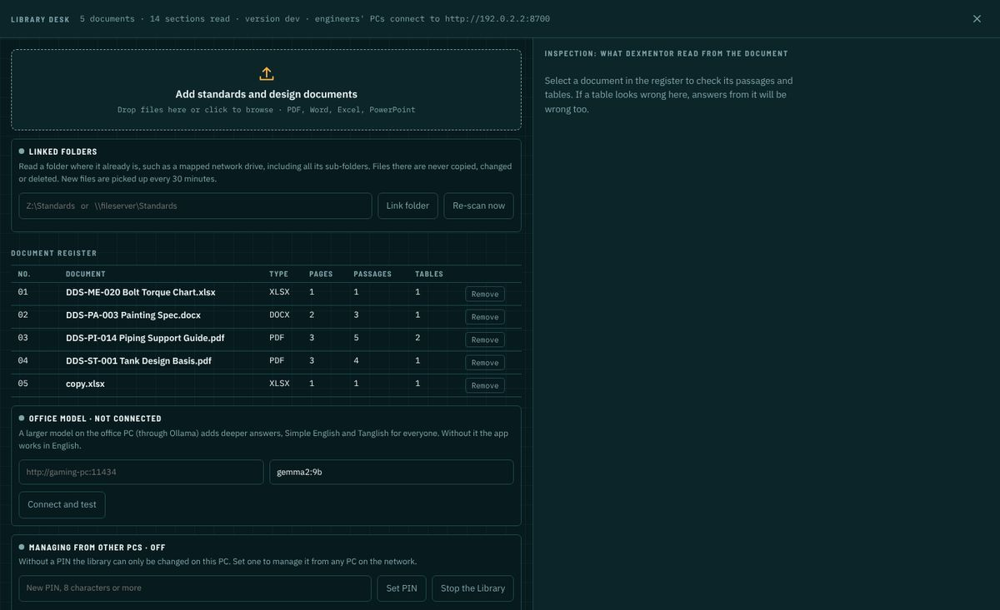

<p align="center">
  <a href="https://dexterity-admin.github.io/oil-gas-design-queries/"></a>
</p>

<p align="center">
  <a href="https://github.com/dexterity-admin/oil-gas-design-queries/releases/latest"></a>
  <a href="https://github.com/dexterity-admin/oil-gas-design-queries/actions/workflows/release.yml"></a>
  <a href="https://github.com/dexterity-admin/oil-gas-design-queries/releases"></a>
  <a href="https://github.com/dexterity-admin/oil-gas-design-queries/commits"></a>
</p>

<h3 align="center">
  <a href="https://dexterity-admin.github.io/oil-gas-design-queries/">🌐 Landing page</a> &nbsp;·&nbsp;
  <a href="https://github.com/dexterity-admin/oil-gas-design-queries/releases/latest/download/DexMentor-Setup.exe">⬇ DexMentor for engineers</a> &nbsp;·&nbsp;
  <a href="https://github.com/dexterity-admin/oil-gas-design-queries/releases/latest/download/DexMentorLibrary-Setup.exe">⬇ DexMentor Library for the server PC</a>
</h3>

---

DexMentor answers engineers' questions from **your company's own standards, design bases and reference documents**. Every fact is pinned to the exact page it came from, and nothing leaves your office.

<p align="center"></p>

## What it does

| | |
| --- | --- |
| **Cited answers** | Each number in an answer carries a balloon. One click opens the original page with the passage highlighted. |
| **Reads the table, not just the words** | Code finds the row and column that match the question and does percentage sums itself. The model only words the answer. |
| **Reads real-world PDFs** | Tables drawn by Word, merged header cells, tables laid on their side and sizes written as fractions (1½", ¾") are all read and matched. "OD" finds "outside diameter" and the other way round. |
| **Reads scanned documents** | A 14 MB reader built into the Library reads scanned pages on the CPU, with nothing extra to install: about 6 seconds a page on an Intel i7-6700 office PC, so a 400-page scanned book takes about 40 minutes once. |
| **Starter pack, kept private** | Keep the company's reference documents in a private GitHub repository. Connect the Library to it once (repository name and a read-only key) and it downloads, indexes and keeps them up to date. Nothing from the pack is in the public installer. |
| **Says when it does not know** | If the library never mentions what is asked, DexMentor refuses and shows the closest passages instead of guessing. |
| **Numbers are checked** | Every number in an answer is checked against the sources. Anything not found is flagged in red. |
| **Private** | Documents, index and models stay on your own PCs. No cloud service is used. |
| **Light** | The engineer app is about 9 MB. It runs a small model only while answering, then frees the memory. |

## The two programs

<p align="center"></p>

| Program | Install on | What it does |
| --- | --- | --- |
| **DexMentor Library** | One always-on PC | Holds and indexes the documents. Drop files in or link a shared network folder (sub-folders included, files are never changed). Shows exactly what was read from each document. |
| **DexMentor** | Every engineer's PC | Finds the Library on the office network by itself, offers a one-time model download, and answers questions. |

### Set-up in three steps

1. Run **DexMentorLibrary-Setup.exe** on the server PC. On the Library desk, add documents or link the folder that holds them.
2. Run **DexMentor-Setup.exe** on each engineer's PC. It connects to the Library automatically. Press *Download model* once.
3. Ask a question.

Windows shows a "Windows protected your PC" notice for the installers because they are not code-signed: choose *More info*, then *Run anyway*. When Windows Firewall asks about DexMentor Library, allow it on private networks, or the engineers' PCs will not find it.

### Starter pack (optional)

Reference books and guides that must not be public can live in a **private** GitHub repository. The Library downloads and indexes them by itself.

1. Put the documents in a private repository.
2. On GitHub, create a fine-grained access token limited to that repository with **Contents: Read-only**.
3. On the Library desk, open **Starter pack**, type `owner/repository`, paste the key and press **Connect**.

### Office model

<a name="office-model"></a>English answers work on every PC with the small built-in model. For deeper answers, Simple English and Tanglish, run [Ollama](https://ollama.com) on one stronger PC and link it from the Library desk (*Office model*).

```bash
ollama pull gemma2:9b
```

Gemma 2 9B was the best of the 7 to 10B models we tested on our question set (29 of 30, with no invented or wrong values). Set the environment variable `OLLAMA_HOST=0.0.0.0` on that PC so the Library can reach it.

## How answers are kept honest

```
question ─► rewrite follow-ups ─► search (keywords + meaning)
         ─► code picks the table row / column and does the percent arithmetic
         ─► code refuses if the library never mentions the subject
         ─► model writes the answer from the sources only
         ─► code checks every number against the sources ─► stamp or red flag
```

The matcher, the arithmetic, the coverage check and the number check are plain code with unit tests (`tests/`), not model behaviour. When the matcher is unsure it says nothing rather than point at a row.

**Limits you should know.** The number check proves a value was not invented. When the matcher has picked a table row, a value the answer takes from one of the other rows is flagged in red ("check the row"); beyond that the check cannot prove a value came from the right place, so the highlighted page still matters. Scores come from a small set of test documents, not your library. Scanned pages are read by a small built-in reader (no extra install); it leaves out numbers it is unsure of, so always check dimensions from a scan against the page shown. Old `.doc`, `.xls` and `.ppt` files are not read.

## For developers

```bash
pip install -r requirements.txt
```

```bash
python -m server
```

```bash
python -m pytest -q tests
```

| Path | What |
| --- | --- |
| `server/` | Library server: ingestion, scanned-page reader, search, grounding, chat pipeline, starter pack, admin API |
| `starter/` | Company-owned documents placed here ship inside the Library installer |
| `web/` | The interface served by the Library (engineer app and Library desk) |
| `desktop/` | Engineer-PC launcher: model download, on-demand model, LAN discovery |
| `installer/` | Inno Setup scripts for both Windows installers |
| `eval/` | Question set and harness used to compare models on GitHub Actions |
| `site/` | The landing page (GitHub Pages) |
| `legacy/` | The original PySide6 prototype |

**Project state, what is proven and what is not, and the next steps: [docs/HANDOVER.md](docs/HANDOVER.md).**

Every push builds both installers, smoke-tests them on Windows and publishes a [release](https://github.com/dexterity-admin/oil-gas-design-queries/releases). The landing page is redeployed whenever `site/` changes on `master`.

<p align="center"><sub>Built by <b>Dexterity International</b> · Contractors &amp; Engineers F.Z.C</sub></p>
